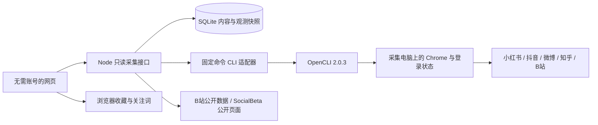

# 当前运行架构

网页 React + Vite；服务 Express；存储 node:sqlite。`server/sources.js` 负责公开源；`server/cli.js` 负责 GitHub 开源 CLI 白名单调用与标准化。

标准条目：id、title、url、source、publishedAt（可缺失）、fetchedAt、tags、topics、categories、metrics。不同平台热度不能直接比较，抖音热点值不写入视频播放量字段。

公开源每 5 分钟更新，CLI 已连接来源每 15 分钟更新；手动检查至少间隔一分钟，CLI 串行执行、有超时。断开时保留历史与最近成功时间，禁止伪装刷新成功。网页每 10 秒读取服务状态，无需重复向平台请求。

平台会话留在浏览器或本机 CLI 目录，不通过 HTTP 返回 Cookie；CLI 参数用 execFile 数组传递，禁止任意 shell。HTTP 仅提供固定来源、限长关键词与来源检查。默认服务绑定 127.0.0.1。

暂未实现：全平台完整涨粉榜、语义模型分析、合作品牌预测、公开互联网部署。数据来源登录是采集端连接流程，不是网站用户账号系统。
