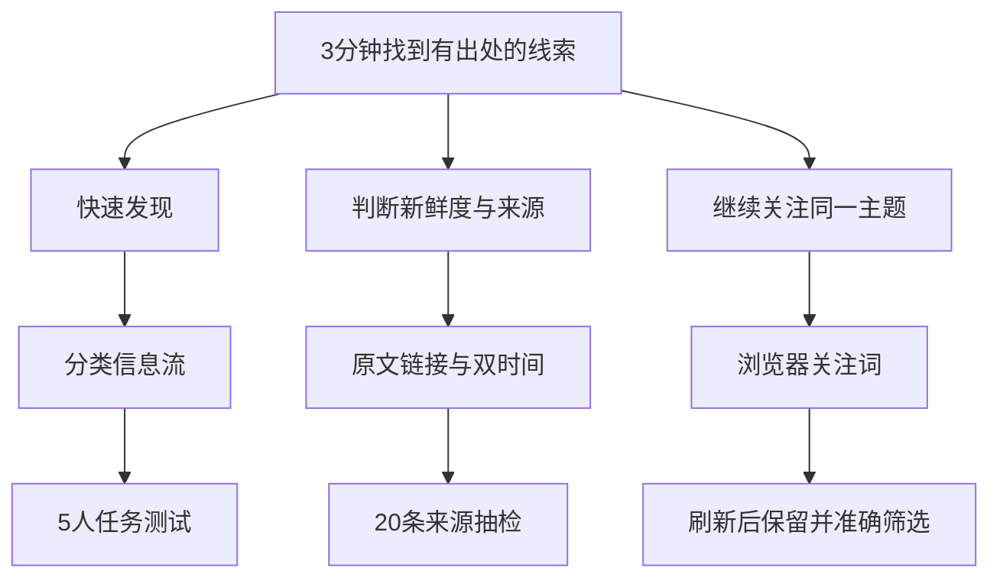

# 知潮：实时潮流发现网站

版本：v1.0 工作稿，2026-11-16。本文替代 bmad-output/archive-v0.8 中的旧版范围。连接验收未全部完成前不交付。

## 1. 概述
用户打开网页即可发现热门 IP、热门内容、亚文化话题及品牌跨界、新品动向。网站从公开来源与 GitHub 开源 CLI 获取信息，保留原文链接和采集时间。

## 2. 联系人
李畅：需求提出与平台登录协助；朱萝茜：业务背景提供者。未假设已完成访谈、组织审批或上线授权。

## 3. 背景
原方案包含销售流程、账号体系和持续推送。用户明确简化为信息发现工具，并要求先确认抖音、小红书、微博、知乎、B站五个平台实际连接，再交付。

## 4. 目标
核心结果：内部员工不需要培训，在 3 分钟内找到一条与研究主题相关、能打开原文的信息。
建议首轮由 5 名同事各完成一次任务，至少 4 人独立完成；这是假设的验收目标，尚未实测。
数据门槛：五个平台均须实际返回非空、可追溯数据；每条保留来源、采集时间，来源未提供发布时间则明确缺失；连接失败不能显示成功。

## 5. 用户与任务
- 希望快速了解“现在有什么值得看”的员工：不需要了解 CLI 或爬虫。
- 带着 IP、品牌或亚文化主题寻找素材的员工：搜索、筛选、查看来源。
- 希望下次继续看相关信息的员工：在本机浏览器保存关键词和收藏。

## 6. 价值
将多平台信息集中浏览，让用户少切换页面；把来源证据和数据缺失直接显示出来。热门内容和账号涨粉分开计算，媒体报道与官方公告不混为一谈。没有已验证的竞争优势或全网覆盖承诺。

## 7. 方案
### 7.1 操作路径
打开网站 → 选择分类或搜索 → 筛选来源／发布时间 → 点击详情 → 查看原始内容 → 按需收藏或关注关键词。
联网搜索另设明确按钮，目前实现小红书笔记与抖音话题的 CLI 调用。普通输入只搜索已采集内容，不伪称全网搜索。

### 7.2 功能边界
- 发现页：全部、热门 IP、热门内容、亚文化、品牌动向五类。
- IP 与品牌线索：按公开标题、标签、明确 IP 关键词归类，显示依据；没有伪造的合作预测分数。
- 可视化：样本内分类数量、话题提及次数、真实播放量快照。没有两次观测时不生成曲线。
- 来源状态：已连接、待连接、暂不可用；错误保留上次数据和时间。
- 更新：公开来源每 5 分钟；已连接的 CLI 来源每 15 分钟；用户可手动检查。平台自身的数据更新可能滞后。
- 关注与收藏：只存在当前浏览器，不跨设备同步；关注只筛选已采集样本。
- 粉丝变化：限定有明确作者 ID 与至少跨 24 小时的观测，显示观测区间；一次搜索不等于涨粉榜。
- 移除：所有账号、管理员、登录、建联跟进、报告导出、网页推送、如流推送。

### 7.3 技术
React 网页 + Node 服务 + SQLite 快照存储；OpenCLI 作为小红书、抖音、微博、知乎的开源采集适配层。B站公开接口与 SocialBeta 品牌快讯已有真实响应。CLI 使用固定只读命令，不提供任意命令执行接口。

### 7.4 假设与限制
- 页面与接口可能变化，必须保持失败可见；不会绕过验证码或平台登录限制。
- 平台登录仅发生在运行采集服务的电脑上，与网站用户账号无关。
- 抖音当前接入的是创作者中心热点词／话题搜索，不等于全站视频检索。
- 小红书推荐具有个性化，不等于全站热度榜。分类存在误差，需查看原文。
- 用户没有提供数据商业接口或模板授权包。Envato Ncmaz 已选为信息架构参考；当前代码独立实现，未使用付费模板源码。

## 8. 发布与验收
阶段一：逐个验证五个平台的 CLI/数据链路、来源链接与更新时间；需用户协助扫码。
阶段二：完成筛选、搜索、收藏、关注、来源提示与桌面／手机界面测试。
阶段三：五个平台验收通过后交付本机可运行版本；远程部署需再确定运行电脑／服务器及网络地址。
后续可增加经验证的数据源；不能为了填满界面加入模拟热点或虚构指标。

## 机会梳理（PM Skills Marketplace）
单一结果：3 分钟找到有出处的相关线索。以下来自本次需求，不是用户访谈统计；采用定性优先级。

| 用户需要 | 可选方案（比较后选择） | 当前选择 | 验证方式 |
|---|---|---|---|
| 我不知道今天值得看什么（高） | 多分类信息流／纯对话问答／单平台榜单 | 多分类信息流 | 5 人找线索，4 人在 3 分钟内完成 |
| 我不知道信息是否够新、可信（高） | 原文与时间／统一评分／人工周报 | 原文与时间 | 抽查 20 条，来源与时间无伪造 |
| 我想持续看同一主题（高） | 浏览器关注词／账号订阅／推送通知 | 浏览器关注词 | 刷新网页仍保留关键词且结果匹配 |
| 我想比较内容的发展（中） | 原始快照曲线／单次互动数／黑箱预测 | 原始快照曲线 | 两次真实快照前无曲线，无基线不显示涨粉 |

