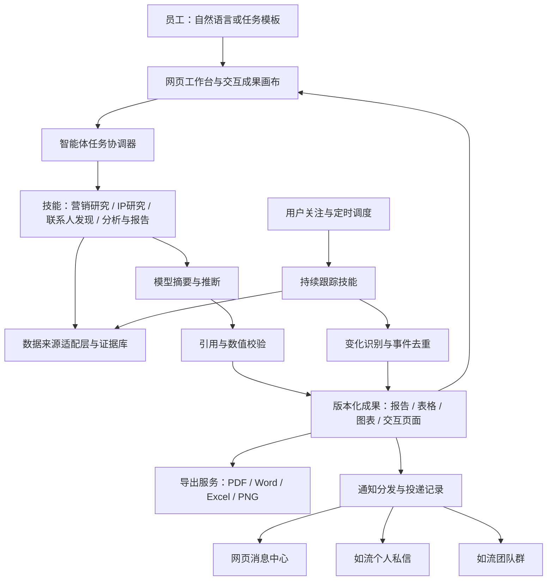

> 已被 2026-11-16 简化方案替代。当前有效需求见根目录 PRD-知潮.md；账号、管理员、销售跟进、导出和推送均已取消。本文保留为历史参考。

# 智能营销情报与 IP 研究智能体｜整体架构
版本：v0.8｜2026-11-07｜设计稿，尚未部署或接通业务数据。

## 1. 总体结构

三条业务线并列：智能营销情报、IP研究跟踪、销售支持。所有能力通过一个智能体工作台提供给非技术员工；网页负责研究与交互，如流负责便捷接收，网页消息中心同步保留完整动态。

## 2. 给员工的使用方式

首页：左侧导航、中央任务对话、右侧成果画布。员工点击模板或输入一句话后开始研究；界面显示“查找资料→整理对比→生成结果”，支持停止和继续。成果可切换表格/图表、筛选对象、查看证据、加入关注、生成报告和导出。

导航建议：工作台、营销情报、IP研究、建联线索、我的关注、消息中心、报告库。管理员入口单独放置，不把接口、密钥或模型参数放进员工流程。

智能体能够推进多步骤任务，但由有限步骤、执行时限、来源白名单和调用额度约束；缺少关键条件才提问。历史对话只作为当前用户和任务的上下文，团队知识与个人跟进备注分别管理。

## 3. 技能设计

| 技能 | 输入 | 输出 |
|---|---|---|
| 智能营销研究 | 主题、产品、机构、时间范围 | 新动态、产品对比、案例拆解、证据 |
| IP研究 | IP、别名、文化主题、研究问题 | 档案、变化时间线、可比趋势、相关机构 |
| 品牌与卖点分析 | 品牌画像、已知产品事实、研究证据 | 适配维度、卖点假设、反例、验证建议 |
| 建联线索发现 | IP侧/品牌侧、目标角色 | 机构关系、公开商务渠道、核验状态 |
| 商机分析 | 研究成果＋选定销售服务卡 | 信号、可能需求、服务适配、应找角色与切入点 |
| 可视化与报告 | 已校验数据、研究结论、目标格式 | 可交互研究页、文档、图表与数据表 |
| 持续跟踪 | IP或营销主题、事件类型、来源、刷新频率 | 增量事件、摘要及来源缺口 |
| 双渠道推送 | 订阅、摘要版本、收件目的地 | 网页消息、如流私信/群消息、分别记录投递状态 |

这里的技能是产品内可复用的执行流程，不意味着必须运行多个独立模型代理。第一版建议一个协调器调用经过限定的工具即可。

## 4. 数据来源与即时性

来源层预留官方/获准接口、获准数据服务、公开商务网页、员工链接录入与CSV导入。小红书、B站是候选来源，尚未验证所需全站数据能力；任何来源必须通过样本、字段、频率和权限验证后才可标为已接通。

主动查询最新信息时发起刷新，返回最近成功时间、原文发布时间、采集时间、覆盖范围及错误。后台建议提供15分钟/1小时/每日档位，但只开放实际来源配额、成本及能力支持的频率；不能许诺全网秒级实时。新发现的旧消息单独标识，资料导入不冒充自动获取。

每个来源保存更新阈值、最近成功时间和下一次计划时间。超阈值显示过期；不可访问不等于对象没有新动态。联系人网页被重新读取不等于任职重新得到确认。

## 5. 数据对象

| 对象 | 关键字段 |
|---|---|
| User / Credential / Session | 用户、admin/user角色、唯一用户名、密码哈希、账号状态、会话有效期 |
| Topic / Entity / Alias | 营销主题、IP、产品、机构、别名、关键词及排除条件 |
| Source / SourceRun | 来源能力、权限范围、频率、任务状态、最近成功时间 |
| Content / Observation | 来源ID/链接、允许保留的摘要、发布时间、发生时间、发现时间、采集时间、版本 |
| MetricSnapshot | 对象、指标、值（可空）、单位、口径、观测时间 |
| EvidenceLink / Event | 结论与来源关系、事件聚合、转载关系、纠正及更新 |
| Organization / Contact / Relationship | 机构、人员/商务渠道、职务、关系类型、有效期、来源与核验状态 |
| Lead / Followup | 负责人、跟进状态、真实跟进记录、下一步事项 |
| BrandProfile / ServiceCard | 品牌画像版本、服务能力、限制、获准案例 |
| Analysis / Hypothesis | 问题、结论、证据、推断标签、画像/模型/提示模板版本 |
| Artifact / ArtifactVersion | 交互成果、数据集、视图配置、报告章节、数据截止点、权限 |
| Subscription | 用户或团队、对象/主题、事件类型、时间、刷新档位、目的地、暂停状态 |
| Summary / InboxItem | 摘要版本、时间窗口、事件集合、站内收件人、未读状态 |
| ChannelBinding / Delivery | 如流用户映射或群绑定、摘要版本、目的地、状态、发送尝试、回执 |
| ExportJob / Job / AuditLog | 导出格式、状态、下载有效期、任务记录、用量、关键变更 |

来源缺失或撤回时，依赖结论标记证据失效并重新评估。全文与原始资料的留存期限按来源条件和团队需求确定。联系方式来源、收录时间与核验时间均单独保存。

## 6. 分析与交互页面如何生成

先清洗、去重、关联实体和形成证据集合，再让模型按固定结构输出摘要、分析或假设。数值计算由确定性程序完成，模型负责解释；引用必须指向实际存在的来源，事实、来源自述、员工输入和模型推断分开。

不直接比较不同平台不同口径原始热度；有至少两次可比观测才展示变化，不把缺失值当零。品牌适配按人群、品类、风格和场景逐项说明，避免未经校准的成功率。案例中供应商宣称的效果须标为来源自述。

成果使用受控组件规范：表格、折线图、条形图、时间线、关系图、机会卡、报告章节。智能体输出数据引用和视图配置，前端渲染；不执行外部资料或模型返回的任意网页代码。筛选和切换视图在同一数据集上即时完成，改变研究范围才生成新版本。

报告导出采用相同版本化数据：PDF/Word包含摘要、章节、静态图表和参考来源；Excel包含选定数据列与数据说明；PNG包含图表、标题、口径及时间。导出是异步任务，显示进度、失败重试和可下载结果。临时文件受权限和有效期控制。PPT为后续候选。

## 7. 持续跟踪流程

1. 员工关注IP、营销主题、产品或机构，并设置事件和个人/群订阅。
2. 调度器按来源频率运行；同一对象的采集可共用，用户关注和权限独立。
3. 根据来源ID、内容版本与事件聚合发现新增、实质更新或纠正；转载不重复计数。
4. 每日发送前刷新或核验，生成指定窗口的增量摘要，并注明来源缺口。
5. 保存网页消息与摘要版本，同时通过投递记录分发到如流。
6. 用户可暂停、取消或调整时间；关闭网页不影响后台任务。停用账号停止个人推送。

每日09:00（Asia/Shanghai）为建议默认值，用户可修改。无新动态默认可发送简短状态，支持静默选项；采集失败必须单独说明。补采历史事件标为“补充发现”，不伪装成当日事件。

## 8. 网页与如流双渠道

网页消息先持久化，打开页面时用服务端事件流或轮询更新未读数；关闭页面后再次打开仍可查历史。浏览器系统弹窗不是首版必需，不要求员工授予系统通知权限。

如流个人私信与群机器人分为独立适配器。私信需要企业应用消息能力及可靠身份绑定；群摘要只使用显式共享给群的订阅，不自动公开个人关注。普通员工通过“连接如流/选择群”的业务操作配置，凭据由管理员处理。

官方材料证明存在如流群机器人接入路径，但本项目尚未验证实际企业权限、个人消息API、可用格式和网络可达性。不能仅凭群Webhook将个人私信标为完成。文本＋网页详情链接为最低可用格式，富卡片和图表附件按真实能力增强。

每份摘要拥有固定ID和版本，各目的地拥有独立投递记录。数据库事务同时保存摘要和待投递记录，后台可靠发送；已确认成功不再重复发送。请求超时但可能已发送时记录“状态未知”，若平台支持幂等/查询则核实后重试，否则提示管理员，避免宣称绝对不重发。

网页已读不推断如流已读。消息接口接受只记为“已发送/接口接受”，不记为员工已读。群消息不默认展开联系人明细和个人跟进备注；网页链接保持登录和访问校验。

## 9. 技术与内部运行

建议初期采用一个网页应用、一个应用服务、一个关系型数据库及可独立运行的后台任务进程；配置任务队列、调度、文件存储与通知适配层。先按单团队设计，无需提前拆分多个独立服务。

具体框架、数据库产品和模型供应商在内部网络、预算、数据来源与如流权限确认后选择。Codex用于开发，持续任务运行在内部服务器或获准云环境，不能依赖个人电脑或聊天窗口持续打开。

密钥只在后台；所有操作检查用户/团队权限。链接读取限制来源并阻止访问内网地址；外部内容视为资料，不接受其中的工具执行指令。联系人只使用公开商务信息或团队有权使用的资料，不猜邮箱，不自动外联。

每日备份并进行恢复演练；任务有超时、重试上限、预算上限与可见状态。模型费用、数据费用、服务器和导出资源分别记录。

## 10. 分阶段交付

| 阶段 | 交付与验收 |
|---|---|
| A 设计 | PRD、架构、Figma可编辑与可点击原型；所有示例明确标注 |
| B 可行性验证 | 至少一个营销来源与一个IP来源的真实样本；如流私信与群消息分别测试；新鲜度实测 |
| C 核心研究 | 管理员分配账号登录、模板任务、证据、IP/营销研究、品牌及建联、交互成果、报告导出 |
| D 跟踪与双推送 | 订阅、增量识别、网页消息中心、如流双通道、失败/重复/暂停场景 |
| E 非技术员工试用 | 无技术文档完成研究、看证据、切图、关注、导出；记录实际效率、数据质量及投递结果 |

最终首版验收以PRD为准。分阶段不意味着删减已确认功能。未接通来源和消息权限前，不承诺实时能力、交付日期或运行费用。

## 11. 主要依据

- [B站开放平台](https://open.bilibili.com/doc/)：需按具体权限验证数据能力。
- [小红书开放平台介绍](https://school.xiaohongshu.com/en/open/index.html)：可见电商相关接口介绍，不足以确认全站热点能力。
- [百度智能云：以如流为例的Webhook接入](https://cloud.baidu.com/doc/CProm/s/plvw6g49h)：支持群机器人路径的设计依据，非本项目接入成功证明。
- [DuMate接入如流指南](https://aca.bce.baidu.com/doc/Dumate/s/Jmnpw4x00)：可作为企业应用接入参考，不据此推定本项目私信权限已具备。

## 12. 核心能力深化：IP发展与合作品牌发现（v0.6）

优先实现“发展跟踪→合作品牌发现→销售准备”的路径，同时保留独立营销情报工作流。

IP发展画像包含作品/角色变化、内容主题、可获得的受众证据、合作历史、渠道覆盖及阶段性事件。先形成事件时间线和同口径观测，再提出带依据的发展阶段判断；热度曲线是辅助信号，不能单独决定发展阶段。

品牌发现过程：从IP的受众/场景/风格提取可检索条件→从可用品牌资料与公开活动建立候选→排除明确冲突→按人群、品类场景、风格价值观、价格渠道、合作历史、时机信号逐项比较→检查证据→输出短名单。未接入可靠受众数据时只给受众假设，不伪造画像。

扩展数据：BrandCandidate（来源、检索条件、候选状态）、FitAssessment（维度结论、证据、未知项、冲突）、RecommendationVersion（IP画像版本、品牌数据版本、研究目标、变更原因）、Opportunity（服务适配、合作形式、应联系角色、下一步）。候选品牌无需事先人工建档，确认后再沉淀为团队品牌画像。

每次新发展事件到达后只重算受影响的候选与分析，保留新入选/降级理由。推荐结果不能越过明确排除条件。模型给出的品牌存在性、公开活动、合作记录必须校验；无法确认的候选降级为待核实。

销售支持衔接：品牌对比→卖点假设→选择实际服务→双方目标角色→公开商务入口与核验→负责人和真实跟进记录→报告/线索表导出。预算、采购计划和意愿未知时保留未知，不通过模型填补。

验证：建立代表性IP与品牌测试集，对前5候选进行人工盲评；历史回看仅用当时可得信息；统计依据完整性、明显冲突率、可用线索比例与准备时间。正式模型概率校准与成交预测不属于当前阶段。

## 13. 统一研究项目与运行逻辑（v0.7）

Project作为工作入口，关联目标、用户、主题、对象、时间范围和分享范围；底层Entity、Content、Evidence、Contact复用，Analysis和Artifact通过版本引用它们。销售Opportunity归属Project并关联IP与BrandCandidate，Followup保存人工行为。

任务执行状态：待开始→采集中→分析中→生成成果→完成；任一步可进入部分完成、等待补充、失败或已取消。业务跟进状态单独管理，不与采集任务状态混用。

事件驱动关系：
- SourceUpdated：新增观测进入清洗和去重。
- EntityEvidenceChanged：更新IP发展画像或营销专题，识别受影响的分析。
- ProfileRevised：将品牌推荐和旧报告标为可刷新；增量重算，生成新版本与变化说明。
- RecommendationReviewed：保存员工采纳/驳回原因，调整项目内候选；不将采纳当成交标签。
- ArtifactPublished：生成网页消息，再按启用的如流订阅投递；同一版本跨渠道关联。
- ContactEvidenceChanged：标记相关线索需核验并提醒负责人，不自动改写任职与真实联系结果。

每个结果保存依赖的证据ID和版本。报告版本不可静默覆盖，旧推送打开原摘要版本并提示存在新版本；员工可主动切换最新。重跑以项目、任务范围、输入版本和操作类型保证幂等；模型或消息失败只影响对应步骤。

用户可以在情报、研究、推荐或销售准备任一步结束并导出；系统不强迫完成所有阶段。来源失败、未发现新信息、没有适配品牌、没有商务渠道、投递失败分别处理，不用一个“失败”覆盖全部情况。

## 14. 账号与上手流程（v0.8）

角色只保留admin与user。管理员创建唯一用户名并设置或重置密码、启停账号；用户使用分配的账号登录，不提供自主注册和邀请注册。两种角色通过同一业务权限集使用研究、建联、分析、订阅与导出，仅账号管理和运维配置由管理员控制。

凭据单独存储为带盐密码哈希；管理端不返回明文旧密码。重置密码或停用账号使已有会话失效，停用停止个人订阅投递但保留团队成果。账号管理操作留审计；保留至少一个有效管理员。首次管理员通过部署初始化建立，后续只由管理员分配账号。

首次登录三步引导可跳过：选对象→看结果与证据→关注或导出。普通用户不接触技术参数。如流连接状态明确区分未开通、未绑定、待测试、可发送和暂时异常；不预设企业具体授权页面。员工确认目的地并主动测试后启用，连接教程提供管理员协助说明，未连接不影响网页使用。
